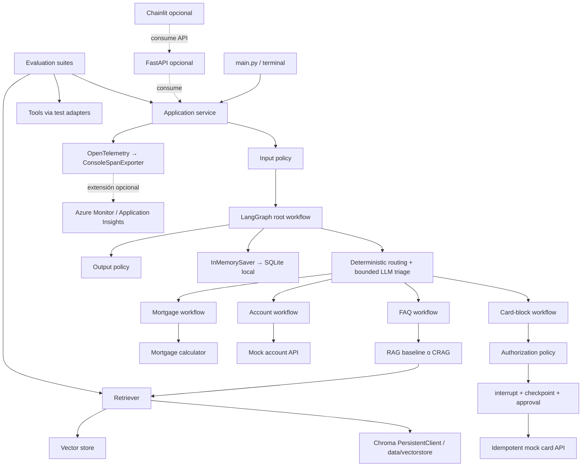

# Plan técnico: laboratorio progresivo de IA agentic bancaria

## Propósito y alcance

Diseñar e implementar progresivamente un sistema de IA con varios workflows, RAG, herramientas, evaluación, observabilidad, seguridad, persistencia y aprobación humana (HITL). El proyecto es un laboratorio educativo local que usa una API key de OpenAI; no procesa datos reales ni representa un sistema bancario de producción.

El principio que gobierna el roadmap es:

> **Baseline → medir → identificar una debilidad → introducir una capacidad → volver a medir → conservarla solo si mejora el resultado dentro de sus costes y riesgos.**

La segunda regla es:

> **Local-first → añadir infraestructura externa solo cuando sea necesaria para aprender un concepto concreto.**

El runtime principal se ejecuta en una PC con Python, LangGraph, LangChain OpenAI, OpenAI API, Chroma persistido en disco, RAGAS, OpenTelemetry con `ConsoleSpanExporter` y pytest. Checkpointing empieza con `InMemorySaver` y evoluciona a SQLite local antes de implementar HITL. No se requieren Docker, PostgreSQL, Azure, una API web ni una interfaz gráfica. Cada fase agrega complejidad por una razón observable y registra sus trade-offs.

El dominio es un asistente de atención bancaria con cuatro resultados de negocio: contestar preguntas sobre información ficticia, simular una hipoteca, consultar datos de una cuenta simulada y tramitar una solicitud sensible de bloqueo de tarjeta con aprobación humana. Las cifras, personas, cuentas, políticas y tarjetas son sintéticas.

### Qué significa cada mecanismo

| Necesidad | Mecanismo | Ejemplo del laboratorio | Cuándo no usar algo más complejo |
|---|---|---|---|
| Regla conocida y cálculo repetible | Función Python determinista | Cuota de una hipoteca | No pedirle al LLM hacer aritmética financiera |
| Consultar un servicio o fuente de datos | Tool/adaptador | API mock de cuenta o tarjeta | La respuesta del LLM no es la fuente de verdad |
| Buscar conocimiento no incluido en el prompt | RAG | Políticas, horarios y productos ficticios | No usar RAG para datos transaccionales actuales |
| Interpretar una solicitud ambigua | Nodo de LLM con salida estructurada | Clasificar una intención o extraer parámetros | No convertir cada paso en un agente autónomo |
| Ejecutar estados y transiciones conocidos | Workflow LangGraph | Triage → FAQ / hipoteca / cuenta / tarjeta | Un grafo no requiere que cada nodo razone con un LLM |
| Elegir dinámicamente herramientas o estrategia | Agente | Extensión experimental, solo si las rutas fijas no bastan | No es el punto de partida ni sin límites de herramientas |
| Aprobar una acción sensible | HITL | Aprobar o rechazar un bloqueo de tarjeta | Una simulación no es una acción transaccional |
| Filtrar contenido dañino | Moderación | Clasificación de contenido | Moderación no autentica, autoriza ni evita prompt injection |

**Términos del proyecto:** un *workflow* es un flujo acotado con transiciones conocidas; un *nodo LLM* hace una tarea lingüística acotada; una *tool* es una interfaz a una operación o dato externo; un *agente* puede seleccionar pasos/herramientas dinámicamente; *RAG* recupera contexto y lo aporta a una generación; una *acción transaccional* modifica estado externo; *handoff* transfiere el control a otro workflow o a una persona.

## Evolución de la arquitectura

### A. RAG baseline

```text
Pregunta
   ↓
Embedding → vector search → top-k chunks → respuesta LLM
```

El primer RAG registra IDs, scores, contextos y latencias. Todavía no reescribe consultas, no tiene grader correctivo y no se llama desde un grafo multi-workflow.

### B. Después del routing

```text
Request → triage (LLM estructurado)
             ├── FAQ → RAG
             ├── Hipoteca → extracción de parámetros → función Python
             ├── Cuenta → tool → servicio mock
             └── Bloqueo/queja → workflow acotado / handoff humano
```

### C. CRAG como mejora comparada

```text
FAQ → retrieve → grade relevancia
                    ├── suficiente → generar con contexto aceptado
                    └── insuficiente → reescribir query → retrieve otra vez
                                                ├── suficiente → generar
                                                └── límite alcanzado → abstenerse / handoff
```

### D. Seguridad y HITL para una acción sensible

```text
Propuesta de bloqueo
  ↓
validación de esquema → autorización determinista → registro pending_approval
                                                    ↓
                                              interrupt/checkpoint
                                                    ↓
                                    decisión humana: aprobar/rechazar
                                                    ↓
                                  autorización final → tool idempotente
                                                    ↓
                                  audit log → output policy → respuesta
```

### E. Arquitectura final objetivo del laboratorio



El grafo es un workflow controlado, no un supervisor libre. El LLM produce clasificación, extracción, generación o resumen; el código decide transiciones permitidas, valida argumentos, aplica autorización y determina si una tool puede ejecutarse. La arquitectura objetivo se alcanza localmente; API, UI y Azure son consumidores/adaptadores opcionales.

## Estructura propuesta

La estructura se implementa por fases; el árbol muestra el destino, no una obligación de crear todos los archivos al inicio.

```text
ai-practice-p1/
├── README.md
├── PLAN.md
├── pyproject.toml
├── .env.example
├── .gitignore
├── data/
│   ├── knowledge_base/                 # políticas y FAQ ficticias, fuente de verdad del RAG
│   ├── eval/                            # datasets versionados, sin credenciales ni PII real
│   ├── mocks/                           # fixtures sintéticos de clientes, cuentas y tarjetas
│   ├── vectorstore/                     # persistencia local de Chroma; regenerable y excluida de Git
│   └── checkpoints.sqlite               # checkpoints locales cuando se habilite SQLite
├── src/bank_assistant/
│   ├── __init__.py
│   ├── config/
│   │   └── settings.py                  # configuración de entorno y límites del runtime
│   ├── models/
│   │   ├── config.py                    # roles y nombres de proveedores/modelos
│   │   └── factory.py                   # creación centralizada de chat models y embeddings
│   ├── domain/
│   │   ├── schemas.py                   # tipos de dominio y contratos Pydantic
│   │   └── errors.py                    # errores de negocio clasificados
│   ├── state/
│   │   └── schemas.py                   # TypedDict del estado LangGraph y reducers
│   ├── application/
│   │   └── service.py                   # interfaz de invocación usada por CLI/API/evaluación
│   ├── graph/
│   │   ├── builder.py                   # composición del grafo y checkpointer
│   │   └── routing.py                   # funciones puras de enrutamiento
│   ├── workflows/
│   │   ├── faq/
│   │   │   ├── baseline.py              # retrieve + generate
│   │   │   └── crag.py                  # grader + rewrite + límite de intentos, fase posterior
│   │   ├── mortgage/workflow.py         # extracción opcional + cálculo determinista
│   │   ├── account/workflow.py          # validación + llamada a cuenta mock
│   │   └── card_block/workflow.py       # propuesta, autorización, HITL y ejecución
│   ├── tools/
│   │   ├── mortgage_calculator.py        # cálculo puro de cuota
│   │   ├── account_api.py               # puerto/adaptador para consulta mock
│   │   ├── card_api.py                  # bloqueo mock idempotente
│   │   └── audit.py                     # registro mínimo de acciones y decisiones
│   ├── rag/
│   │   ├── ingest.py                    # ingesta explícita, fuera del camino de request
│   │   ├── chunking.py                  # política versionada de chunking
│   │   ├── embeddings.py                # creación de embeddings mediante factory
│   │   ├── vectorstore.py               # adaptador de almacenamiento vectorial
│   │   ├── retriever.py                 # consulta y resultado normalizado con IDs/scores
│   │   ├── grader.py                    # relevancia de contexto para CRAG
│   │   └── query_rewriter.py             # reescritura acotada, solo para CRAG
│   ├── guardrails/
│   │   ├── input_policy.py              # límites y validación determinista de entrada
│   │   ├── injection_detection.py       # señal heurística; no frontera de seguridad
│   │   ├── output_policy.py             # validación/redacción antes de responder
│   │   ├── authorization.py              # policy determinista de identidad/acción/argumentos
│   │   └── moderation.py                 # moderación de contenido, separada de autorización
│   ├── persistence/
│   │   └── checkpointer.py              # InMemorySaver primero; SQLite local después
│   ├── observability/
│   │   ├── tracing.py                   # proveedor/exporter y spans
│   │   ├── metrics.py                   # contadores, histogramas y coste estimado
│   │   └── privacy.py                   # atributos permitidos y política capture_content=false
│   ├── api/                              # opcional, después de estabilizar CLI/runtime
│   │   ├── app.py                       # FastAPI y ciclo de vida
│   │   └── schemas.py                   # contratos HTTP, no estado interno del grafo
│   └── main.py                          # CLI del laboratorio; sin lógica de dominio
├── evaluation/
│   ├── datasets/                        # casos y etiquetas por suite
│   ├── common/                          # carga de casos y salida de resultados
│   ├── rag/run.py                       # RAGAS + métricas propias de retrieval
│   ├── routing/run.py                   # métricas de clasificación
│   ├── tools/run.py                     # selección y argumentos de tools
│   ├── end_to_end/run.py                # éxito de objetivos por workflow
│   ├── security/run.py                  # pruebas adversariales automatizables
│   └── results/                         # reportes reproducibles, sin prompts sensibles
├── tests/
│   ├── unit/
│   ├── integration/
│   └── e2e/
└── notebooks/                           # exploración; no contiene lógica runtime
```

### Responsabilidad, contrato y dirección de imports

| Módulo | Input → output | Quién lo importa | Quién no debería importarlo / motivo |
|---|---|---|---|
| `config/settings.py` | entorno → settings validados | composition root, factories, API | Dominio puro y herramientas de cálculo no deberían leer variables globales |
| `models/config.py` | rol lógico → `ModelSpec` | `models/factory.py`, configuración | Workflows no deberían codificar credenciales, endpoints ni nombres de deployment |
| `models/factory.py` | spec + credenciales → cliente LLM/embeddings | nodos LLM, RAG | `graph/routing.py` y domain no construyen proveedores |
| `domain/schemas.py` | datos externos validados → tipos de negocio | tools, workflows, guardrails | No debe importar LangGraph, OpenAI, FastAPI ni vector DB |
| `state/schemas.py` | estado tipado del workflow | graph y nodos/workflows | No debe importar el builder ni instanciar servicios |
| `tools/*` | argumentos tipados → resultado tipado | workflows y tests | No deben decidir el routing ni construir prompts |
| `rag/ingest.py` | archivos fuente → índice | comando de ingesta | No debe ejecutarse por cada request ni ser importado por el graph builder |
| `rag/retriever.py` | consulta → documentos, IDs, scores, duración | FAQ workflow y evaluación | No importa `graph/*`, API ni datasets de evaluación |
| `workflows/faq/*` | estado/consulta → respuesta y evidencia | `graph/builder.py`, evaluación vía application/retriever | No importa `graph/builder.py` ni API; evita ciclo workflow ↔ graph |
| `graph/routing.py` | estado → nombre de ruta permitida | builder y tests | Funciones puras; no llama al LLM ni a una tool |
| `graph/builder.py` | dependencias → grafo compilado | application service | API, UI y tools no montan subgrafos por su cuenta |
| `application/service.py` | request/command → resultado de aplicación | CLI, FastAPI, evaluación E2E | La UI no debe invocar nodos internos o duplicar routing |
| `guardrails/authorization.py` | principal + acción + args + contexto → allow/deny | workflows antes de cada efecto sensible | Nunca delegar su decisión al prompt ni al grader |
| `persistence/checkpointer.py` | backend local configurado → `InMemorySaver` o `SqliteSaver` | composition root | Los nodos no deben crear un saver por invocación |
| `observability/*` | eventos permitidos → spans/métricas | application, graph wrapper, adapters | No registrar prompts completos ni datos bancarios por defecto |
| `api/*` | HTTP → aplicación y DTO HTTP | cliente/UI, solo en extensión opcional | No contiene negocio, prompts ni lógica LangGraph |
| `evaluation/*` | casos etiquetados + runtime → reportes | importa API pública de aplicación/RAG/tools | Código runtime nunca importa `evaluation/*` |

**Reglas para evitar ciclos y acoplamiento:** las dependencias apuntan hacia contratos de menor nivel; `graph` compone workflows, nunca al revés; `rag/*` no conoce el grafo; `tools/*` no conocen prompts ni agentes; la evaluación consume el runtime y sus interfaces, pero el runtime no conoce datasets ni métricas; proveedores concretos se construyen en factories/composition root y no se instancian dispersos. Si un módulo inferior necesita un servicio superior, se pasa una función/interfaz por parámetro en lugar de importar hacia arriba.

Mapa resumido:

```text
CLI / API
   ↓
application/service
   ↓
graph/builder → routing + workflows
                         ↓
            domain / tools / rag
                         ↓
             provider adapters

 evaluation → application / retriever / tools públicos
 evaluation -X→ runtime inverso (prohibido)
 rag/*      -X→ graph/* (prohibido)
 tools/*    -X→ prompts, UI, graph builder (prohibido)
```

## Configuración y proveedores de modelos

### Roles lógicos

```text
ROUTER_MODEL       clasificación acotada; candidato a SLM solo tras medir baseline
GENERATION_MODEL   respuesta FAQ y resúmenes
GRADER_MODEL       relevancia de retrieval en CRAG; opcional y separado
EMBEDDING_MODEL    vectores de consulta/documentos; no es un chat model
```

Un `ModelSpec` contiene `provider`, `model_name`, `deployment` opcional y parámetros compatibles. La configuración define qué spec usa cada rol; `factory.py` lo materializa. Inicialmente se usa el proveedor OpenAI con `OPENAI_API_KEY`. Ningún módulo de workflow debe repetir `ChatOpenAI(model=...)` ni crear clientes globales durante el import.

### Provider, model, deployment, endpoint y credentials

- **Provider**: servicio o implementación que sirve la inferencia (OpenAI, Ollama, Azure OpenAI/Microsoft Foundry).
- **Model**: familia/versión lógica del modelo, por ejemplo el modelo de chat o embeddings que acepta el proveedor.
- **Deployment**: recurso/configuración desplegada que expone un modelo bajo un nombre; Azure puede exigir usar el nombre de deployment en vez del nombre público del modelo.
- **Endpoint**: dirección de red a la que conecta el cliente; no es el modelo ni una credencial.
- **Credentials**: API key o identidad administrada que autentica la llamada; se obtienen del entorno/secret store y nunca se versionan.

Una factory reduce cambios de integración, pero no hace intercambiables todos los proveedores automáticamente: diferencias de structured output, tool calling, dimensiones de embeddings, límites y parámetros requieren un adaptador y pruebas de compatibilidad. La lógica de negocio depende de interfaces y contratos comunes, no de una promesa de equivalencia perfecta.

### Variables previstas

`.env.example` documenta nombres sin valores secretos; `.env` permanece ignorado por Git.

```dotenv
OPENAI_API_KEY=
ROUTER_MODEL=
GENERATION_MODEL=
GRADER_MODEL=
EMBEDDING_MODEL=
VECTORSTORE_PATH=./data/vectorstore
CAPTURE_CONTENT=false
MAX_GRAPH_STEPS=12
MAX_RETRIEVAL_ATTEMPTS=2
MAX_TOOL_RETRIES=2
LLM_TIMEOUT_SECONDS=30
TOOL_TIMEOUT_SECONDS=5
MAX_TOKENS_PER_REQUEST=4000
MAX_ESTIMATED_COST_USD=
```

Los valores exactos se fijan en `settings.py`, se validan al arrancar y se exponen en logs solo si son no sensibles. Un presupuesto no reemplaza límites del proveedor: se valida antes/después de llamar y la llamada debe tener timeout/token limit.

## Contratos de estado y ejecución

El estado es información serializable de una ejecución; no se guardan clientes, locks ni instancias de proveedor dentro de él. Evoluciona de forma mínima por fases.

```python
class AssistantState(TypedDict, total=False):
    messages: list[Any]
    request_id: str
    intent: str
    confidence: float
    retrieved_contexts: list[str]
    retrieved_document_ids: list[str]
    retrieval_scores: list[float]
    retrieval_attempts: int
    rewritten_query: str | None
    proposed_action: dict[str, Any] | None
    approval_status: str | None
    idempotency_key: str | None
    tool_result: dict[str, Any] | None
    retry_count: int
    response: str
```

En implementación, los tipos y reducers deben ser explícitos; los mensajes usan el reducer de LangGraph apropiado para no reemplazar el historial accidentalmente. Los datos de tarjeta deben ser identificadores sintéticos/tokenizados; el estado no almacena PAN/CVV. No añadir campos antes de que una fase los necesite.

## Política de límites, fallos y reintentos

```text
MAX_GRAPH_STEPS             límite de transiciones/nodos del workflow (recursion_limit)
MAX_RETRIEVAL_ATTEMPTS      límite de ciclos retrieve/grade/rewrite; baseline no reintenta
MAX_TOOL_RETRIES            reintentos de una operación segura/idempotente
LLM_TIMEOUT_SECONDS         timeout por llamada de modelo
TOOL_TIMEOUT_SECONDS        timeout por llamada a adaptador
MAX_TOKENS_PER_REQUEST      presupuesto aproximado de generación
MAX_ESTIMATED_COST_USD      corte presupuestario opcional por request
```

`network retry != workflow retry`. Un retry de red vuelve a intentar una llamada ante timeout, rate limit, error temporal de red o 5xx, con exponential backoff, jitter, timeout total y máximo de intentos. No se reintentan automáticamente errores de autorización, argumentos inválidos, schemas persistentemente inválidos, tool inexistente ni rechazos de política. Los reintentos del workflow son transiciones de estado (por ejemplo, CRAG hace retrieve de nuevo) y tienen un contador distinto. Una tool con efectos externos no se reintenta sin clave de idempotencia o semántica equivalente.

## Evaluación: más que una puntuación RAGAS

Los datasets son versionados, sintéticos y etiquetados manualmente. Cada corrida guarda `run_id`, commit/version del código, versiones de dependencias, proveedor/model IDs, parámetros, dataset/version, fecha, latencia, uso de tokens, coste estimado y métricas. Nunca se guarda una API key; los resultados por defecto no guardan prompts completos.

| Capa | Datos por caso | Métricas/validación |
|---|---|---|
| Routing | `expected_intent`, `predicted_intent`, `confidence` | accuracy, precision, recall, F1 por clase, matriz de confusión; revisar falsos negativos de tarjeta/fraude |
| Retrieval | query, documentos relevantes esperados, IDs/scores recuperados | RAGAS Context Precision/Recall, hit rate, MRR, Recall@K; considerar cobertura de preguntas sin respuesta |
| Generation | question, contexts efectivamente usados, answer, ground truth | RAGAS Faithfulness y Answer/Response Relevancy; revisión humana de muestra |
| Tools | tool esperada/observada, args esperados/observados, resultado esperado | selección correcta, exactitud de argumentos, éxito/error, ausencia de ejecución no autorizada |
| End-to-end | objetivo y precondiciones/resultado esperado | objetivo completado, salida correcta, ruta correcta, abstención correcta, latencia y coste |
| Seguridad | ataque/caso benigno pareado, acción permitida esperada | tasa de bloqueo esperada, falsos positivos, tool invocations no autorizadas = 0 |
| Operación | trazas y series de requests | p50/p95, fallos, retries, tokens, coste estimado y timeout rate |

RAGAS mide la calidad de preguntas con respuestas de referencia/contextos; no reemplaza hit rate/MRR, tests deterministas, revisión humana ni evaluación de seguridad. Sus APIs y nombres de métricas cambian entre versiones: fijar la versión en `pyproject.toml`, verificar la API instalada y documentar el adaptador en `evaluation/rag/`. No comparar corridas si cambió el dataset o el modelo sin etiquetar ese cambio.

### Comparación obligatoria

Cada mejora debe producir una tabla comparable, por ejemplo:

| Variante | Faithfulness | Context Recall | Hit@K | p95 latency | tokens/request | coste/request | Errores |
|---|---:|---:|---:|---:|---:|---:|---:|
| RAG v1 baseline | medir | medir | medir | medir | medir | estimar | medir |
| CRAG | medir | medir | medir | medir | medir | estimar | medir |

Se conserva CRAG solo si mejora la debilidad objetivo y su mejora justifica latencia/coste. Se aplica la misma regla al routing OpenAI vs SLM, memoria local vs persistencia, retrieval simple vs query rewriting y llamada directa vs HITL. No se predefine una victoria antes de ejecutar el benchmark.

## Seguridad, autorización y privacidad de telemetría

La defensa se compone de controles distintos, no de un único clasificador:

```text
User → input policy → detección de injection → triage/workflow
     → propuesta de tool → schema + allowlist + authorization determinista
     → HITL si aplica → ejecución → audit log → output policy → respuesta
```

- **Input policy**: límites de tamaño/formato, campos permitidos y validación; no pretende entender todas las intenciones maliciosas.
- **Injection detection**: reglas/heurísticas iniciales y quizá un detector separado en experimentos. Una señal basada en LLM puede fallar y nunca se trata como autorización ni como frontera de seguridad.
- **Moderation**: detecta categorías de contenido según un proveedor/política; no valida identidad, ownership, permisos o argumentos.
- **Authorization**: código determinista verifica principal autenticado (mock en local), acción permitida por workflow, ownership del recurso, schema/valores, estado actual y necesidad de aprobación. Se valida otra vez inmediatamente antes de ejecutar la tool.
- **Output policy**: valida formato y minimiza exposición; bloquea/redacta campos que el principal no puede ver.
- **Audit**: registra actor/acción/decisión/resultado con IDs sintéticos y timestamp, no secretos ni contenido irrelevante.

### Política de OpenTelemetry y PII

`CAPTURE_CONTENT=false` por defecto. No hacer `span.set_attribute("prompt", raw_user_prompt)` ni registrar respuestas completas. Capturar metadata mínima: `request_id`/`trace_id`, workflow/intención, proveedor/model ID, estado, cantidad de documentos recuperados, nombre de tool, duración, retries y token counts reportados por el proveedor. Evitar nombres, números de cuenta/tarjeta, contenido de prompts, headers de autorización y API keys. `thread_id` debe ser un UUID opaco, no un dato personal.

Capturar contenido solo en un entorno de pruebas con datos sintéticos, acceso restringido, retención definida y consentimiento/política adecuados; nunca por cambiar un flag en producción sin revisión. Instrumentación automática y spans manuales no deben duplicar llamadas. Si el SDK no informa tokens/coste, usar `unknown` o una estimación etiquetada; coste estimado no es factura real.

## Checkpointing, memoria y acciones

### Checkpointing no es memoria de largo plazo

- **Checkpoint**: snapshot serializable del estado de una ejecución/hilo en un punto del grafo; permite retomar tras pausa/error y habilita HITL. Pertenece al `thread_id` y puede contener datos de esa ejecución.
- **`thread_id`**: clave estable y opaca que identifica la conversación/ejecución persistida, enviada mediante `configurable` al grafo. No autentica al usuario ni concede acceso a un hilo.
- **Resume**: invocación posterior del mismo grafo con el mismo `thread_id` y `Command(resume=...)` para continuar una ejecución interrumpida.
- **Memoria de largo plazo**: conocimiento seleccionado que se reutiliza entre conversaciones. Tiene objetivos, borrado, privacidad, consentimiento y retención propios; no forma parte del MVP inicial.

`InMemorySaver` sirve para aprender y probar dentro del proceso; pierde estado al reiniciar y no es almacenamiento durable. Para persistencia local, el laboratorio evoluciona a `SqliteSaver` y un archivo SQLite. PostgreSQL queda fuera del camino principal y solo podría explorarse como extensión externa opcional. No llamar “memoria del agente” a un checkpointer.

### HITL y estado de acción

Para bloqueo de tarjeta, los estados de negocio son `pending_approval`, `approved`, `rejected`, `executed` y `failed`. `interrupt()` guarda la propuesta y pausa antes del side effect; la persona revisa acción/recurso/resumen, luego se retoma con `Command(resume=decision)`. Un endpoint de aprobación no debe confiar en el `thread_id`: debe comprobar identidad, permiso de aprobación y asociación del action ID.

La ejecución posterior a un interrupt puede volver a correr parte del nodo que contenía la interrupción al reanudarse. Por ello, no ejecutar la acción antes de `interrupt()` y hacer la operación idempotente.

### Idempotencia

Cada propuesta obtiene una clave estable, por ejemplo derivada de `action_id`/solicitud, y se pasa al mock `block_card(card_id, idempotency_key)`. La tool registra la primera respuesta y devuelve la misma ante repetición, sin duplicar el efecto. La clave no cambia en un resume/retry. Un diccionario en memoria sirve solo para pruebas; la garantía tras reinicio requiere deduplicación durable/transaccional en el adapter. Los mocks documentan explícitamente ese límite.

## Fases del roadmap

Todas las fases usan el mismo contrato de lectura: **Objetivo, Problema, Archivos y responsabilidad, Imports/dependencias, Flujo, Implementación, Ejecución, Qué observar, Prueba mínima, Criterio, Errores frecuentes y Estado resultante**. Los comandos asumen Windows PowerShell con el entorno virtual activo desde la raíz. El árbol es una referencia de destino, no una tarea inicial: cada fase crea únicamente los archivos que necesita; no se crean de antemano todas las carpetas ni archivos vacíos.

## CORE

**Fases 0–9 — Primer MVP local funcional:** construir las capacidades principales y conectarlas por CLI.

### Fase 0 — Arquitectura y skeleton

**Objetivo:** fijar límites, casos de uso, datos sintéticos y reglas de evaluación antes de añadir dependencias.

**Problema que resuelve:** evita que el prototipo sea una colección de prompts y agentes sin objetivo ni criterios.

**Archivos y responsabilidad:** `PLAN.md` describe arquitectura; crear directorios vacíos solo al comenzar cada fase; `data/knowledge_base/` tendrá políticas ficticias y `data/mocks/` fixtures sintéticos.

**Imports/dependencias:** aún no hay imports runtime. Los documentos de conocimiento no importan código; el runtime los leerá explícitamente.

**Flujo:** `casos de uso → requisitos → contratos → skeleton`.

**Implementación:** definir FAQ, simulación hipotecaria, consulta de cuenta y bloqueo de tarjeta; etiquetar cuál usa RAG, función determinista, tool mock, LLM o HITL. Escribir política de no PII real y límites de observabilidad.

**Ejecución:** `git status --short` y revisión manual de los casos.

**Qué observar:** cada caso tiene entrada, ruta, fuente de verdad y resultado verificable.

**Prueba mínima:** clasificar 12 consultas sintéticas entre las cuatro capacidades, incluyendo una fuera de alcance.

**Criterio de aceptación:** ningún caso requiere que un LLM invente saldo, estado de tarjeta o cálculo; cada acción sensible tiene un punto de autorización definido.

**Errores frecuentes:** diseñar todos los subagentes desde el primer día; usar políticas reales; llamar “agente” a cualquier función.

**Estado resultante:** hay un alcance progresivo; todavía no existe aplicación ejecutable.

### Fase 1 — Package structure y configuración

**Objetivo:** crear paquete instalable, settings tipados y factories centralizadas para OpenAI.

**Problema que resuelve:** imports frágiles, clientes duplicados, secrets embebidos y modelos repetidos en workflows.

**Archivos y responsabilidad:** `pyproject.toml` define runtime/dev/eval extras; `.env.example` documenta variables sin secrets; `.gitignore` excluye `.env`, `.venv`, `.local/`, `data/vectorstore/`, `data/checkpoints.sqlite`, cachés y resultados locales; `config/settings.py`, `models/config.py`, `models/factory.py` centralizan configuración y construcción.

**Imports/dependencias:** settings → factory; factory puede importar SDK/adapters; dominio no lee entorno. API key viene del entorno, nunca de un archivo versionado.

**Flujo:** `.env → Settings validado → ModelSpec por rol → factory → cliente de proveedor`.

**Implementación:** factory pública: `build_chat_model(role)` y `build_embeddings()`. Inyectar instancias en nodos; evitar creación al importar módulo. Mantener nombres de rol independientes de nombres comerciales.

**Ejecución:** `python -m venv .venv`; `\.venv\Scripts\Activate.ps1`; `python -m pip install -e ".[dev,eval]"`; `python -c "from bank_assistant.config.settings import get_settings; print(get_settings().model_dump(exclude={'openai_api_key'}))"`.

**Qué observar:** configuración validada; no aparece key en output; import del paquete funciona desde raíz.

**Prueba mínima:** missing key produce error claro solo al construir cliente, no al importar módulos de dominio.

**Criterio de aceptación:** `pip install -e .` funciona, `.env` está ignorado y existe un único lugar para cada rol de modelo.

**Errores frecuentes:** imprimir settings completos; instanciar clientes globales en import-time; confundir deployment con model.

**Estado resultante:** paquete y configuración listos, sin workflow ni llamadas por defecto.

### Fase 2 — Estado LangGraph y contratos Pydantic

**Objetivo:** definir estado serializable de ejecución y esquemas de dominio.

**Problema que resuelve:** mensajes y parámetros inconsistentes entre nodos dificultan el routing, las pruebas y el checkpointing futuro.

**Archivos y responsabilidad:** `domain/schemas.py` define intención, usuario mock, simulación, propuesta/resultado de acción; `state/schemas.py` define `AssistantState` y reducers del grafo; `domain/errors.py` clasifica errores.

**Imports/dependencias:** state/domain pueden usar typing y Pydantic; no importan LangChain, proveedor, API ni builder. Los nodos los consumen.

**Flujo:** `request DTO → validación Pydantic → estado tipado → nodos`.

**Implementación:** usar `Literal`/Enums para intents y estados; restricciones numéricas para monto/plazo; serializar solo datos necesarios. El estado puede ser `TypedDict` y los objetos de frontera Pydantic; no serializar clientes.

**Ejecución:** `python -m pytest tests/unit/test_schemas.py`.

**Qué observar:** entradas incompletas/malformadas generan errores tipados sin llamar al LLM.

**Prueba mínima:** intención desconocida, importe negativo, tarjeta inexistente y decisión de aprobación inválida.

**Criterio de aceptación:** esquemas rechazan valores fuera de dominio y son serializables.

**Errores frecuentes:** dejar todo como `dict[str, Any]`; hacer que el schema conozca el grafo; guardar secretos en estado.

**Estado resultante:** contratos listos; aún no se ejecutan tools ni se enruta.

### Fase 3 — Tools deterministas y mocks

**Objetivo:** establecer fuentes de verdad simuladas y cálculo puro.

**Problema que resuelve:** evita que el LLM calcule o fabrique datos transaccionales.

**Archivos y responsabilidad:** `tools/mortgage_calculator.py` calcula cuota; `tools/account_api.py` consulta fixtures; `tools/card_api.py` simula bloqueo; `tools/audit.py` registra eventos mínimos; `data/mocks/*.json` son fixtures sintéticos.

**Imports/dependencias:** tools importan contratos de dominio; workflows las invocarán. No importan LLM, graph, prompts ni API. Fixtures los carga el adapter, nunca los compone el modelo.

**Flujo:** `parámetros validados → tool/adaptador → resultado de dominio`; para cuenta: `account_id → mock service → balance/transactions`.

**Implementación:** hipoteca con fórmula de amortización implementada y probada en Python; datos de cuenta/tarjeta salen solo de fixture. Declarar estas interfaces: `calculate_payment(input)`, `get_account(account_id)`, `block_card(card_id, idempotency_key)`.

**Ejecución:** `python -m pytest tests/unit/test_tools.py`.

**Qué observar:** resultados deterministas para mismos inputs; IDs inexistentes generan error de dominio, nunca datos inventados.

**Prueba mínima:** cuota conocida calculada con tolerancia decimal, saldo de fixture exacto, tarjeta desconocida denegada.

**Criterio de aceptación:** los tests pasan sin API key ni llamadas de red.

**Errores frecuentes:** consultar el LLM para completar un saldo; usar datos reales; mezclar formato de respuesta con lógica de negocio.

**Estado resultante:** funciones/tool mocks utilizables de forma aislada; todavía no hay RAG ni grafo.

### Fase 4 — RAG baseline

**Objetivo:** implementar retrieve → top-k → generate con fuentes ficticias y registrar evidencia de retrieval.

**Problema que resuelve:** las respuestas sobre políticas deben apoyarse en documentos y poder inspeccionarse.

**Archivos y responsabilidad:** `rag/chunking.py` transforma documentos; `embeddings.py` usa factory; `vectorstore.py` encapsula Chroma; `ingest.py` indexa bajo demanda; `retriever.py` retorna IDs, scores, texto y duración; `workflows/faq/baseline.py` genera con contexto.

**Imports/dependencias:** `ingest → chunking/embeddings/vectorstore`; `retriever → embeddings/vectorstore`; FAQ importa retriever y generation factory. Ningún `rag/*` importa graph ni evaluation. Ingest no corre en request.

**Flujo:**

```text
Markdown → chunk → embedding → Chroma persistido
query → embedding → top-k + scores/IDs → contexto → generación con fuente
```

**Implementación:** usar Chroma `PersistentClient` con ruta `./data/vectorstore/`; no hay servidor ni contenedor que levantar. Conservar metadatos `document_id`, `source`, `chunk_id`, `chunking_version`; generar abstención cuando no existe contexto suficiente. Guardar IDs, scores, contextos y latencia para evaluación; no tratar similarity score como probabilidad calibrada.

**Ejecución:** `python -m bank_assistant.rag.ingest`; luego `python -m bank_assistant.main --mode rag-smoke`. La ingesta escribe archivos locales en `data/vectorstore/`, que se excluyen de Git y pueden regenerarse desde la base de conocimiento.

**Qué observar:** consulta, documentos devueltos, score/latencia y respuesta con referencias internas a fuentes.

**Prueba mínima:** pregunta cuya respuesta existe en un documento conocido y query sin respuesta en la base.

**Criterio de aceptación:** el documento esperado aparece entre top-k para casos semilla; pregunta no soportada se abstiene; re-ejecutar no reindexa accidentalmente cada request.

**Errores frecuentes:** no persistir IDs; chunking que separa título de regla; asumir que score alto significa correcto; responder desde conocimiento paramétrico sin evidencia.

**Estado resultante:** RAG v1 ejecutable como módulo aislado, sin triage, CRAG ni workflow root.

### Fase 5 — Dataset inicial

**Objetivo:** fijar casos de referencia separados por capacidad y crear un conjunto dorado pequeño.

**Problema que resuelve:** las impresiones manuales no permiten saber si retrieval/routing mejora.

**Archivos y responsabilidad:** `data/eval/rag.jsonl` incluye query, ground truth, documentos/chunks relevantes; `routing.jsonl` incluye intent esperado; `tools.jsonl` incluye tool/args esperados; `end_to_end.jsonl` incluye objetivo y resultado.

**Imports/dependencias:** solo `evaluation/common` carga datasets; runtime nunca importa datasets.

**Flujo:** `casos sintéticos etiquetados → runner → resultado estructurado`.

**Implementación:** empezar con 20-30 casos balanceados para routing y al menos 15 preguntas RAG variadas, incluyendo preguntas sin respuesta. Cada caso tiene `case_id`, `dataset_version`, `expected_*`; no incorporar PII.

**Ejecución:** `python -m evaluation.common.validate_datasets`.

**Qué observar:** conteo por clase, campos faltantes, duplicados y referencias a documentos inexistentes.

**Prueba mínima:** validar al menos FAQ, fuera de alcance, hipoteca, saldo, tarjeta y prompt injection benigno/adversarial.

**Criterio de aceptación:** dataset validado y versionado; separar desarrollo y holdout para no ajustar prompts sobre todos los casos.

**Errores frecuentes:** usar respuestas del modelo como ground truth; desbalancear clases; editar etiquetas para favorecer la nueva versión.

**Estado resultante:** hay casos reproducibles, sin scores baseline todavía.

### Fase 6 — Evaluación baseline de RAG

**Objetivo:** medir retrieval y generation antes de CRAG.

**Problema que resuelve:** no existe evidencia de qué parte del RAG falla ni de cuánto cuesta.

**Archivos y responsabilidad:** `evaluation/rag/run.py` usa el mismo retriever y FAQ generation path; `evaluation/common/` valida resultados; `evaluation/results/` guarda JSON/CSV de corrida.

**Imports/dependencias:** evaluación consume interfaz pública `retriever`/workflow; nunca copia la lógica de chunking/retrieval ni se importa desde runtime.

**Flujo:** `dataset → retriever → generator → RAGAS + hit/MRR/latency → report`.

**Implementación:** recoger `question`, `contexts` efectivamente entregados, `answer` y `ground_truth`; calcular hit rate/MRR/Recall@K junto con métricas RAGAS compatibles con versión fijada.

**Ejecución:** `python -m evaluation.rag.run --dataset data/eval/rag.jsonl --variant rag-v1`.

**Qué observar:** contexto correcto recuperado, faithfulness/relevancy, fallos, tokens y duración por caso.

**Prueba mínima:** correr subset local determinista de retrieval, luego el conjunto con llamadas reales a OpenAI.

**Criterio de aceptación:** baseline reproducible guardado con proveedor/modelo, parámetros, versión de dataset y código; no se exige umbral arbitrario aún.

**Errores frecuentes:** puntuar solo generación; comparar datasets distintos; esconder respuestas fallidas por promedios; asumir que RAGAS elimina revisión humana.

**Estado resultante:** RAG v1 tiene métricas iniciales y una debilidad identificable.

### Fase 7 — Triage con LLM acotado

**Objetivo:** clasificar solicitudes a una unión finita de intents con salida estructurada.

**Problema que resuelve:** texto libre requiere seleccionar un workflow, pero el routing debe terminar en una ruta conocida.

**Archivos y responsabilidad:** añadir `workflows/triage.py` o `graph/triage_node.py` (un nodo LLM, no un agente general); ampliar schema de clasificación y suite `evaluation/routing/run.py`.

**Imports/dependencias:** triage importa schema y factory de `ROUTER_MODEL`; no importa tools ni ejecuta las acciones que clasifica. `routing.py` valida/normaliza la salida.

**Flujo:** `mensaje → LLM structured output → intent/confidence → ruta allowlisted o clarify/handoff`.

**Implementación:** definir clases `faq`, `mortgage`, `account`, `card_block`, `complaint`, `out_of_scope`; unknown/invalid/confidence baja va a aclaración o handoff, nunca a ejecución sensible. Accuracy no basta: reportar precision/recall/F1 y matriz.

**Ejecución:** `python -m evaluation.routing.run --model-role router --dataset data/eval/routing.jsonl`.

**Qué observar:** etiquetas, confidence, errores de parseo, tokens, latencia; sin registrar prompt crudo en spans.

**Prueba mínima:** fake model para unit tests y subset de OpenAI para baseline real.

**Criterio de aceptación:** rutas válidas siempre; evaluar falsos negativos de `card_block` por separado antes de conectarlo a una tool.

**Errores frecuentes:** dejar al LLM retornar nombre de nodo arbitrario; tratar confidence como autorización; reintentar el mismo prompt indefinidamente.

**Estado resultante:** clasificación evaluable; aún no existe root graph.

### Fase 8 — Root LangGraph y workflows

**Objetivo:** conectar nodos/workflows mediante transiciones explícitas y límites de ejecución.

**Problema que resuelve:** llamadas aisladas no mantienen control de estado ni rutas verificables.

**Archivos y responsabilidad:** `graph/routing.py` funciones puras; `graph/builder.py` registra nodos/edges; `workflows/*` implementa FAQ, hipoteca y cuenta; card workflow inicialmente solo prepara handoff sin efecto.

**Imports/dependencias:** builder importa state, routing y workflows; workflows no importan builder. Composición de modelos/tools pasa por argumentos/dependencias.

**Flujo:** `START → input → triage → una ruta permitida → output → END`.

**Implementación:** edges condicionales cerrados; contador/límite con `MAX_GRAPH_STEPS`; no enrutar de vuelta a triage sin una transición con presupuesto y condición explícitos. La simulación usa extracción estructurada opcional y función Python; consulta cuenta usa tool mock.

**Ejecución:** `python -m bank_assistant.main --mode graph-smoke`.

**Qué observar:** nodo visitado, estado actualizado y terminación sin ciclos.

**Prueba mínima:** invocar builder con fake triage y probar cada mapping de ruta sin OpenAI.

**Criterio de aceptación:** cada intent válido termina en su workflow; desconocido finaliza en clarify/handoff; pasos máximos se hacen cumplir.

**Errores frecuentes:** importar graph desde workflow; usar retorno LLM como nombre de nodo sin validar; estado mutable compartido entre requests.

**Estado resultante:** root workflow determinista con routing LLM acotado; no hay seguridad/HITL completo.

### Fase 9 — MVP end-to-end por CLI

**Objetivo:** ofrecer una interfaz CLI fina que use una misma application service.

**Problema que resuelve:** hace posible validar el ciclo completo sin acoplar la lógica a un notebook.

**Archivos y responsabilidad:** `application/service.py` crea/invoca runtime y transforma resultados; `main.py` solo entrada/salida CLI; `tests/e2e/` casos por ruta.

**Imports/dependencias:** CLI importa application service; application compone graph; CLI no importa nodos/tools internos.

**Flujo:** `CLI → application service → graph → workflow/tool/RAG → resultado`. La tarjeta muestra que falta aprobación y no ejecuta.

**Implementación:** mantener contexto/thread por sesión explícito; hacer errores presentables sin filtrar exception details/secrets.

**Ejecución:** `python -m bank_assistant.main`.

**Qué observar:** FAQ, cuota determinista, dato account mock, queja/fuera de alcance.

**Prueba mínima:** cinco escenarios en terminal, incluyendo pregunta sin soporte; repetir con y sin key según ruta.

**Criterio de aceptación:** rutas deterministas pasan con fake models; solamente paths LLM requieren key; no hay saldo inventado.

**Errores frecuentes:** acumular conversación indefinida; mostrar objetos internos de LangGraph; incluir negocio en `input()` loop.

**Estado resultante:** MVP local multi-workflow útil sin aún ejecución de acción sensible.

#### Checkpoint A — MVP funcional

Al terminar la Fase 9, la CLI ejecuta un grafo LangGraph con rutas para FAQ/RAG baseline, simulación hipotecaria determinista, consulta de cuenta mock y solicitudes de tarjeta que todavía no ejecutan la acción. Los tests de rutas y herramientas pueden correr con fakes, sin llamadas externas; solo las capacidades LLM requieren OpenAI API.

**Fases 10–13 — Observabilidad, evaluación y comparación RAG vs CRAG:** añadir señales locales, fijar el baseline medido y comprobar si la complejidad adicional mejora resultados.

### Fase 10 — OpenTelemetry tracing local

**Objetivo:** observar la estructura y duración de la ejecución antes de añadir más ramas.

**Problema que resuelve:** sin trazas es difícil atribuir latencia/fallo a triage, retrieval, generation o tool.

**Archivos y responsabilidad:** `observability/tracing.py` configura SDK/exporter; `privacy.py` define atributos seguros; wrappers en application/nodos crean spans.

**Imports/dependencias:** composition root inicializa provider una sola vez antes de construir/invocar runtime; los nodos importan una interfaz de tracing o usan contexto activo. No duplicar instrumentación automática y manual.

**Flujo:** `request → graph.invoke → node spans → ConsoleSpanExporter`.

**Implementación:** spans `request`, `graph.invoke`, `triage`, `faq`, `embedding/retrieval`, `generation`, `tool`; atributos low-cardinality y sin contenido crudo.

**Ejecución:** `python -m bank_assistant.main --mode graph-smoke`.

**Qué observar:** árbol parent/child, duración, status/error y workflow.

**Prueba mínima:** test de span para ruta FAQ y ruta de tool; verificar `CAPTURE_CONTENT=false`.

**Criterio de aceptación:** un trace por request con spans jerárquicos; no aparecen prompt, respuesta, key o datos de fixtures sensibles.

**Errores frecuentes:** inicializar tracer varias veces; capturar cuerpos HTTP automáticamente; nombres de span dinámicos con IDs que disparan cardinalidad.

**Estado resultante:** tracing local útil; exportación cloud aún ausente.

### Fase 11 — Métricas de runtime y presupuestos

**Objetivo:** medir latencia, errores, retries, tokens y costes estimados por request.

**Problema que resuelve:** tracing muestra una ejecución, pero no tendencias ni regresión agregada.

**Archivos y responsabilidad:** `observability/metrics.py` define histograms/counters; settings añade budgets; reportes usan misma semántica.

**Imports/dependencias:** wrappers de proveedores extraen usage metadata; metrics no conoce el contenido de prompts ni el dominio bancario.

**Flujo:** `provider/tool result → usage metadata → metrics + trace attrs → resumen por corrida`.

**Implementación:** agregar `latency`, `retry_count`, `input_tokens`, `output_tokens`, `retrieval_count`, `tool_name`, outcome; coste por precio/version configurada, etiquetado como estimación. Aplicar timeout/token/cost caps donde el proveedor permita.

**Ejecución:** `python -m evaluation.end_to_end.run --smoke --report evaluation/results/runtime-smoke.json`.

**Qué observar:** p50/p95 tras suficientes muestras, errores y costo por request; muestras insuficientes se marcan, no se presentan como p95 estable.

**Prueba mínima:** simular timeout, rate limit y request normal; verificar contadores separados.

**Criterio de aceptación:** budgets/timeout no se omiten en llamadas; errores/retries se registran sin datos privados.

**Errores frecuentes:** llamar al coste estimado coste real; sumar tokens cuando proveedor no reporta usage; mezclar retry de red con vuelta de workflow.

**Estado resultante:** calidad/operación tienen señales medibles para justificar la siguiente complejidad.

### Fase 12 — Corrective RAG (CRAG)

**Objetivo:** añadir grader y reescritura solo al workflow FAQ si el baseline muestra retrieval débil.

**Problema que resuelve:** top-k puede ser irrelevante o insuficiente aun con generación correcta.

**Archivos y responsabilidad:** `rag/grader.py` evalúa suficiencia; `query_rewriter.py` reformula; `workflows/faq/crag.py` controla ramas y tope; state añade `retrieval_attempts`, `retrieved_contexts`, `retrieval_scores`, `rewritten_query`.

**Imports/dependencias:** workflow FAQ importa retriever, grader y rewriter; los tres son puros respecto del graph builder. `MAX_RETRIEVAL_ATTEMPTS=2` limita el ciclo.

**Flujo:** `retrieve → grade → (sufficient: generate | insufficient: rewrite → retrieve) → abstain/handoff on limit`.

**Implementación:** grader devuelve schema con `relevant`, evidencia/razón corta y score si se justifica; query rewriter retorna una query, nunca cambia autorización ni intent; si tras el límite no hay contexto válido, abstenerse. Mantener RAG v1 disponible por configuración para benchmark.

**Ejecución:** `python -m bank_assistant.rag.ingest`; `python -m evaluation.rag.run --variant crag`.

**Qué observar:** número de intentos, query inicial/final (solo en dataset sintético, fuera de telemetry por defecto), documentos aceptados, latencia/coste.

**Prueba mínima:** fake grader devuelve pobre→bueno; otra secuencia siempre pobre y verifica máximo dos retrievals y abstención.

**Criterio de aceptación:** ninguna ruta excede el máximo; errores de grader fallan closed hacia abstención o baseline explícito, no loop infinito.

**Errores frecuentes:** confiar ciegamente en un LLM grader; reescribir hasta encontrar respuesta; generar desde chunks rechazados.

**Estado resultante:** RAG v2 CRAG listo para medir, todavía no asumido superior.

### Fase 13 — Re-evaluación baseline vs CRAG

**Objetivo:** comparar RAG v1 y CRAG sobre exactamente el mismo dataset y condiciones.

**Problema que resuelve:** CRAG añade llamadas/latencia; sin control experimental se confunde complejidad con mejora.

**Archivos y responsabilidad:** `evaluation/rag/run.py` soporta variantes; `evaluation/results/` registra metadata y tabla; no duplicar dataset.

**Imports/dependencias:** mismo runner, retriever y generator; cambia configuración/estrategia explícita.

**Flujo:** `mismo holdout → baseline → CRAG → comparar calidad + recursos + fallos`.

**Implementación:** versionar prompt/model/chunking/top-k; hacer múltiples ejecuciones si hay variabilidad; revisar paired cases donde cambió respuesta.

**Ejecución:** `python -m evaluation.rag.run --compare rag-v1,crag --dataset data/eval/rag.jsonl`.

**Qué observar:** tabla de métricas, regresiones, coste/request, p95 y tasa de abstención.

**Prueba mínima:** comprobar que runner rechaza comparar corridas con dataset/model incompatibles sin marcarlo.

**Criterio de aceptación:** dejar recomendación documentada en el reporte; CRAG solo se vuelve default si resuelve la debilidad a coste aceptable.

**Errores frecuentes:** celebrar un agregado que esconde regresión de clase; afinar con holdout; ignorar latencia/coste.

**Estado resultante:** decisión experimental explícita y trazable entre RAG v1 y v2.

#### Checkpoint B — MVP medido

Al terminar la Fase 13, el sistema conserva resultados comparables del RAG baseline y CRAG sobre el mismo dataset, incluyendo calidad, retrieval, latencia y coste estimado. Las trazas locales permiten localizar trabajo y errores sin capturar prompts ni PII por defecto. CRAG solo queda habilitado como mejora si los datos justifican su coste.

## ADVANCED LOCAL

**Fases 14–20 — Guardrails, autorización, SQLite, HITL, idempotencia y evaluación de seguridad:** extender el MVP medido con controles y estado durable, todo en herramientas locales.

### Fase 14 — Input policy, injection detection y output policy

**Objetivo:** validar entradas y salidas y explorar detección de ataques como señal auxiliar.

**Problema que resuelve:** modelos y RAG reciben texto no confiable; moderación por sí sola no protege integridad ni datos.

**Archivos y responsabilidad:** `guardrails/input_policy.py` límites/schema; `injection_detection.py` heurísticas; `moderation.py` contenido; `output_policy.py` formato/redacción.

**Imports/dependencias:** application llama input policy antes del graph; output policy después; workflows no saltan estos puntos; injection detection no aprueba tools.

**Flujo:** `entrada → límites → detector/señal → workflow → output validation/redaction → respuesta`.

**Implementación:** tamaños, caracteres y campos permitidos de forma determinista; detector etiquetado como advisory; OpenAI Moderation opcional con fallback/error policy explícita; no clasificar moderación como autorización.

**Ejecución:** `python -m pytest tests/unit/test_guardrails.py`.

**Qué observar:** decisión/razón codificada, falsos positivos sobre ejemplos benignos, p95 añadido.

**Prueba mínima:** jailbreak conocido de laboratorio, petición normal que contenga palabras similares y respuesta con dato sintético prohibido.

**Criterio de aceptación:** input oversized/rechazado no llega al modelo; salida viola schema/redaction y no se entrega; una alerta de injection sola no concede ni bloquea permisos críticos.

**Errores frecuentes:** poner el detector en el prompt y llamarlo seguridad; asumir moderación cubre ataques; guardar input completo en spans.

**Estado resultante:** policies de frontera activas; autorización de acciones todavía se incorpora separadamente.

### Fase 15 — Authorization layer

**Objetivo:** imponer permisos y allowlists en código antes de cada tool sensible.

**Problema que resuelve:** un prompt comprometido, modelo equivocado o routing incorrecto no debe ejecutar una acción prohibida.

**Archivos y responsabilidad:** `guardrails/authorization.py` reglas puras; `domain/schemas.py` define Principal/ActionProposal; workflows de cuenta/tarjeta llaman policy; tests unitarios de matriz de permisos.

**Imports/dependencias:** authorization importa contratos de dominio/config de política; no importa LLM, graph builder ni Moderation API. La tool también valida estado/ownership.

**Flujo:** `principal + workflow + action + args + resource ownership → allow/deny + reason`.

**Implementación:** lista de tools permitidas por ruta, validación de argumentos y principal; aprobación requerida para bloqueo; revalidar justo antes de side effect. En local principal es fixture de test, no seguridad HTTP real.

**Ejecución:** `python -m pytest tests/unit/test_authorization.py`.

**Qué observar:** decisión estructurada y negativa ante workflow/user/resource no autorizados.

**Prueba mínima:** model solicita bloqueo de otra tarjeta, tool no permitida en FAQ, monto/ID inválido.

**Criterio de aceptación:** tests prueban que ningún output de LLM puede sobrepasar policy; autorización denegada no reintenta.

**Errores frecuentes:** confiar en `user_id` que envió el cliente sin autenticar; inferir permisos desde el prompt; validar solo al proponer.

**Estado resultante:** operaciones sensibles tienen un límite determinista independiente del modelo.

### Fase 16 — Checkpointing local: InMemorySaver y SQLite

**Objetivo:** entender checkpoints primero en memoria y luego persistirlos en un archivo SQLite local, usando `thread_id` en ambas variantes.

**Problema que resuelve:** HITL necesita preservar estado pendiente sin mantener una llamada bloqueada.

**Archivos y responsabilidad:** `persistence/checkpointer.py` construye el saver seleccionado; `graph/builder.py` recibe saver por inyección; `data/checkpoints.sqlite` guarda checkpoints locales en la variante durable; tests de integración ejercitan hilos y reinicio.

**Imports/dependencias:** builder/application seleccionan `InMemorySaver` al inicio; luego se agrega el paquete `langgraph-checkpoint-sqlite` y `SqliteSaver`. Workflows no instancian saver; application provee `thread_id` y config por request. SQLite es un archivo local, no un servicio que haya que desplegar.

**Flujo:** `InMemorySaver: invoke → checkpoint → mismo proceso → resume`; después `SqliteSaver: invoke → checkpoints.sqlite → reinicio del proceso → mismo thread_id → resume`.

**Implementación:** comenzar con `InMemorySaver` para observar el ciclo sin persistencia; cambiar a `SqliteSaver` para probar recuperación tras reiniciar. `thread_id` es UUID opaco enviado en `configurable`; comprobar aislamiento entre hilos. Excluir el archivo SQLite de Git y no guardar secretos ni datos reales. Es checkpoint de ejecución, no memoria de largo plazo.

**Ejecución:** `python -m pytest tests/integration/test_checkpointer.py`; para la variante durable, ejecutar `python -m pip install langgraph-checkpoint-sqlite` y luego `python -m pytest tests/integration/test_sqlite_checkpointer.py`.

**Qué observar:** `InMemorySaver` pierde el estado al terminar el proceso; `SqliteSaver` lo conserva en `data/checkpoints.sqlite`; ambos aíslan threads.

**Prueba mínima:** pausar una ejecución, cerrar y volver a abrir el runtime SQLite, reanudar el mismo thread y confirmar que thread B no accede al estado de A.

**Criterio de aceptación:** la variante en memoria y la variante SQLite restauran el estado correcto en sus ámbitos definidos; el archivo local no se versiona y la diferencia entre checkpoint y memoria queda documentada.

**Errores frecuentes:** tratar thread_id como autorización; guardar API clients en state; olvidar el ciclo de vida/conexión de SQLite; asumir que un checkpoint equivale a memoria semántica.

**Estado resultante:** checkpoint local durable disponible sin PostgreSQL ni Docker; el grafo está listo para introducir `interrupt()`.

### Fase 17 — HITL para bloqueo de tarjeta

**Objetivo:** implementar propuesta, interrupción, decisión humana y resume sin ejecutar antes de aprobación.

**Problema que resuelve:** un bloqueo cambia estado, por lo que no equivale a responder una consulta ni a simular una cuota.

**Archivos y responsabilidad:** `workflows/card_block/workflow.py` gestiona estados; `authorization.py` valida; `graph/builder.py` compila con `SqliteSaver`; state contiene action ID/status/proposal.

**Imports/dependencias:** workflow llama authorization y luego `interrupt`; application entrega decisión al mismo thread; tool solo se invoca tras aprobación y autorización final. El checkpointer SQLite se crea fuera del workflow y se inyecta al compilar el grafo.

**Flujo:** `collect identifiers → propose → authorize → pending_approval → interrupt → approve/reject → re-authorize → execute or stop`.

**Implementación:** `interrupt()` transmite resumen mínimo y `action_id`; retomar con `Command(resume=decision)` en mismo `thread_id`. Estados permitidos: `pending_approval`, `approved`, `rejected`, `executed`, `failed`. Rechazo no ejecuta tool.

**Ejecución:** `python -m bank_assistant.main --scenario card-block-hitl`.

**Qué observar:** primera llamada queda pausada y devuelve pendiente; la segunda continúa y registra decisión/resultado.

**Prueba mínima:** aprobar, rechazar, thread incorrecto, principal no aprobador y resume repetido.

**Criterio de aceptación:** aprobación explícita precede a la tool; denegación/rechazo termina sin side effect; actor/decisión auditados con datos sintéticos.

**Errores frecuentes:** ejecutar antes de `interrupt`; confiar en texto “sí” sin verificar quién aprueba; mandar PAN/CVV en interrupt payload.

**Estado resultante:** workflow sensible con HITL y checkpoints locales en SQLite, aún sin garantía de idempotencia durable para efectos externos.

### Fase 18 — Idempotencia y clasificación de errores

**Objetivo:** evitar side effects duplicados y reintentos inapropiados al reanudar/reintentar.

**Problema que resuelve:** un crash o resume puede repetir un nodo o una petición de tool.

**Archivos y responsabilidad:** `tools/card_api.py` persiste el resultado por idempotency key; `domain/errors.py` clasifica fallos; tests de tool y workflow cubren repetición.

**Imports/dependencias:** card workflow genera/persiste key estable y la pasa a tool; tool implementa dedupe. Retry helper solo envuelve errores retryable.

**Flujo:** `same action_id/key → first call applies mock once → duplicate call returns recorded result`.

**Implementación:** key ligada a action ID y operación, no regenerada al resume; en mock en memoria, documentar caída/restart; durable dedupe queda como requisito para adapter persistente. Backoff/jitter/máximo solo para timeout/rate limit/network/5xx; no reintentar authorization, invalid request, schema inválido persistente o tool inexistente.

**Ejecución:** `python -m pytest tests/integration/test_card_idempotency.py`.

**Qué observar:** dos invocaciones con misma key producen un efecto y resultado; retry count separado de `retrieval_attempts`/graph steps.

**Prueba mínima:** simular respuesta perdida luego de efectuar acción y repetir misma solicitud.

**Criterio de aceptación:** no duplica efecto en scope documentado; todo retry tiene timeout/backoff/attempt limit.

**Errores frecuentes:** nueva key por cada retry; reintentar side effect sin dedupe; confundir replay LangGraph con retry de HTTP.

**Estado resultante:** workflow HITL repetible con garantía del mock dentro de su storage; persistencia durable aún pendiente.

### Fase 19 — Evaluación de tools y workflows

**Objetivo:** medir herramientas esperadas/argumentos/resultados y éxito end-to-end por capacidad.

**Problema que resuelve:** buena generación no demuestra que se llamó la herramienta correcta ni que el objetivo se completó.

**Archivos y responsabilidad:** `evaluation/tools/run.py`, `end_to_end/run.py`; datasets de tools y objetivos; `tests/integration/` para grafo+fake models+mock tools.

**Imports/dependencias:** evaluation usa application y adaptadores mockados; no reimplementa cálculos ni API mock.

**Flujo:** `caso etiquetado → workflow → capturar route/tool/args/result → comparar expected → report`.

**Implementación:** métricas separadas para selección, precisión de args, resultado de tool, completion, abstention y unauthorized attempts; ejecución determinista sin llamadas LLM en unit/integration.

**Ejecución:** `python -m evaluation.tools.run`; `python -m evaluation.end_to_end.run`.

**Qué observar:** confusiones entre workflows, extractions incorrectas, llamadas fallidas y estados terminales.

**Prueba mínima:** FAQ sin tool, hipoteca correcta, account fixture, tarjeta aprobada y rechazada.

**Criterio de aceptación:** cada objetivo tiene expected route/result; tools transaccionales sin autorización = 0.

**Errores frecuentes:** evaluar solo el texto final; no capturar argumentos; tests que llaman OpenAI sin aislamiento.

**Estado resultante:** evaluación cubre piezas y flujos completos.

### Fase 20 — Dataset adversarial y pruebas de seguridad

**Objetivo:** probar prompt injection, solicitudes no autorizadas, manipulación de parámetros y casos benignos cercanos.

**Problema que resuelve:** pruebas felices no prueban defensa en profundidad ni falsos positivos.

**Archivos y responsabilidad:** `evaluation/security/run.py`, `data/eval/security.jsonl`, `tests/e2e/test_security_flows.py`; incluir expected policy/action, no secretos.

**Imports/dependencias:** suite ejecuta API application con mock model/tools; no cambia reglas de producción para satisfacer dataset.

**Flujo:** `adversarial case → input policy → workflow → authorization → tool call count/output → expected security outcome`.

**Implementación:** casos pareados benigno/hostil; testear injection dentro de documento recuperado, solicitud de cuenta ajena, prompt que pide ignorar reglas y argumentos alterados. Métrica central: ejecución no autorizada debe ser cero; además reportar falso bloqueo.

**Ejecución:** `python -m evaluation.security.run`.

**Qué observar:** etapa que bloqueó/permitió, llamadas a tool, redacción y falsos positivos; el span no captura payload del ataque.

**Prueba mínima:** prompt injection intenta autorizar bloqueo; autorización determinista lo deniega sin importar la salida del LLM.

**Criterio de aceptación:** todos los negativos críticos no ejecutan side effect; resultados benignos se mantienen funcionales.

**Errores frecuentes:** decir “seguro” por pasar un set pequeño; evaluar solo detector; guardar corpus sensible en trazas.

**Estado resultante:** límites demostrables y dataset adversarial versionado, con riesgo residual explícito.

#### Checkpoint C — Laboratorio local completo

Al terminar la Fase 20, el laboratorio local incluye policies de entrada/salida, autorización determinista, checkpoints SQLite, HITL para bloqueo de tarjeta, idempotencia del mock y suites de evaluación de herramientas, workflows y seguridad. Sigue usando OpenAI API como único servicio externo; Chroma usa `PersistentClient` local, OTel exporta a consola y pytest valida los componentes.

## OPTIONAL EXTENSIONS

**Fases 21–25 — FastAPI, UI, Ollama y Azure:** son experimentos independientes, no requisitos para completar AI Practice pt.1. PostgreSQL, si se explora, pertenece únicamente a una posible extensión externa y no reemplaza SQLite en el camino principal.

### Fase 21 (opcional) — FastAPI

**Objetivo:** si se necesita practicar contratos HTTP, exponer application service como backend sin mover lógica de grafo a HTTP. El MVP de terminal ya es válido sin esta fase.

**Problema que resuelve:** CLI es útil para laboratorio pero no establece contrato para otras interfaces.

**Archivos y responsabilidad:** `api/app.py` lifecycle/rutas; `api/schemas.py` DTO HTTP; `application/service.py` conserva lógica; integración API tests.

**Imports/dependencias:** API → application; nunca importa nodos para ejecutar manualmente ni llama tools directamente. UI futura → HTTP API.

**Flujo:** `POST /threads → thread_id`; `POST /chat → invoke/resume-safe response`; `POST /actions/{id}/approve|reject → auth + resume`; `GET /health` → liveness/readiness acotada.

**Implementación:** empezar con `/chat` y health; aprobar requiere principal autenticado en deployment, local usar fixture explícita solo en dev. Validar propiedad/tenant del thread; no exponer checkpoints completos.

**Ejecución:** `python -m uvicorn bank_assistant.api.app:app --reload`.

**Qué observar:** códigos HTTP, IDs de request/thread, traces correlacionados, errores sin stack/secret al cliente.

**Prueba mínima:** FastAPI TestClient con fake model, thread aislado y aprobación no autorizada.

**Criterio de aceptación:** los endpoints usan la misma application service que CLI y API no contiene reglas de negocio.

**Errores frecuentes:** exponer `/approve` sin auth; crear nuevo graph/checkpointer por request; devolver estado interno completo.

**Estado resultante:** backend local consumible por clientes, independiente de UI; puede omitirse sin afectar el laboratorio principal.

### Fase 22 (opcional) — UI como cliente del backend

**Objetivo:** añadir UI pequeña (Chainlit o Streamlit) después de estabilizar contrato API.

**Problema que resuelve:** interacción y visualización de pending approval son incómodas en CLI; no requiere duplicar runtime.

**Archivos y responsabilidad:** `ui/` separado; cliente HTTP; no importar `bank_assistant.graph`.

**Imports/dependencias:** UI → API HTTP exclusivamente; APIs → application. El estado visual pendiente no es fuente de verdad.

**Flujo:** `UI → POST /chat → API/application/graph`; aprobación → endpoint seguro.

**Implementación:** mostrar evidencia/citas y estado pending/approved/rejected; no mostrar datos mock sensibles innecesarios; manejar polling/reconnect sin ejecutar dos veces.

**Ejecución:** `python -m chainlit run ui/app.py` (o comando Streamlit elegido y fijado en extras).

**Qué observar:** reanudación de conversación y estado desde API, no desde lógica UI.

**Prueba mínima:** FAQ y aprobación/rechazo a través de UI apuntando a API local.

**Criterio de aceptación:** backend sigue arrancando y tests sin UI; UI no accede a secrets/model factory/checkpointer.

**Errores frecuentes:** instanciar LangGraph dentro del callback UI; duplicar estado; considerar ocultar botón como autorización.

**Estado resultante:** interfaz reemplazable, sin acoplamiento de negocio; solo se construye si la interacción visual aporta valor al experimento.

### Fase 23 (opcional) — Experimento de routing SLM/Ollama

**Objetivo:** comparar router OpenAI baseline con un modelo local pequeño en el mismo benchmark.

**Problema que resuelve:** routing puede ser coste/latencia relevante, pero SLM puede perder calidad o introducir carga operativa.

**Archivos y responsabilidad:** adapter Ollama bajo `models/`; `models/config.py` añade provider; evaluación routing soporta variantes; resultados separados.

**Imports/dependencias:** `workflows/triage` sigue usando factory/contrato común; solo config selecciona adapter; no añadir fallback híbrido antes del benchmark.

**Flujo:** `same dataset → OpenAI router → Ollama router → quality/latency/cost/operations comparison`.

**Implementación:** medir accuracy, macro F1, recall card-block/fraud, latencia, disponibilidad, coste marginal y coste operacional; después experimentar con deterministic rules → SLM → LLM para ambiguos si falsos negativos lo permiten.

**Ejecución:** `ollama serve`; `ollama pull <modelo elegido>`; `python -m evaluation.routing.run --compare openai,ollama`.

**Qué observar:** calidad por clase, cold-start, memoria/latencia y errores de salida estructurada.

**Prueba mínima:** fixtures idénticos y holdout sin ajustes; probar modelo sin tool-calling, pues router solo clasifica.

**Criterio de aceptación:** decisión basada en métricas y complejidad operacional; router local nunca autoriza acciones.

**Errores frecuentes:** comparar prompts/datasets distintos; usar modelo local por moda; confundir costo monetario bajo con costo operacional cero.

**Estado resultante:** provider local experimental, default sigue siendo el que gane por evidencia.

### Fase 24 (opcional) — Extensión: Azure / Microsoft Foundry

**Objetivo:** explorar cómo se traducen algunos adapters locales a servicios Azure, solo si existe un objetivo de aprendizaje específico. No se requiere suscripción, despliegue ni cambio de proveedor para completar AI Practice pt.1.

**Problema que resuelve:** valida qué abstracciones son útiles y qué diferencias del proveedor necesitan adaptación.

**Archivos y responsabilidad:** si se realiza el experimento, actualizar únicamente configuración/adapters y pruebas de compatibilidad; no mover lógica del dominio ni añadir infraestructura al camino local.

**Imports/dependencias:** los workflows conservan sus contratos; factories/adapters pueden seleccionar Azure. Los paquetes Azure y credenciales son extras exclusivos de esta extensión.

**Flujo:** `mismo workflow → factory/adaptador seleccionado → OpenAI API actual o servicio Azure experimental`.

**Implementación:** comparar una o dos integraciones, no migrar toda la arquitectura por defecto. La API key de OpenAI no es credencial Azure; recursos cloud tienen costos y configuración propios.

**Ejecución:** no hay comandos Azure en el flujo principal. Para el experimento, configurar suscripción, región, modelo y presupuesto antes de crear recursos; también es válido limitarse a una comparación conceptual y de contratos.

**Qué observar:** diferencias de structured output, deployment names, embeddings/dimensiones, cuotas, latencia, permisos y costos.

**Prueba mínima:** contrato de compatibilidad para generación, embeddings, vector retrieval y moderation contra deployment de prueba.

**Criterio de aceptación:** documentar qué adapter se comparó, qué contrato se conserva y qué diferencias aparecen; los recursos cloud son opcionales y no condicionan ninguna fase anterior.

**Errores frecuentes:** asumir “cambiar endpoint” basta; confundir Foundry project/model/deployment; subir `.env` o dejar credenciales en logs.

**Estado resultante:** equivalencias locales/Azure entendidas o un adapter opcional probado; el runtime local permanece como camino principal.

| Componente local | Equivalencia Azure posible | Qué cambia / qué debería permanecer |
|---|---|---|
| OpenAI API | Azure OpenAI / modelo desplegado en Microsoft Foundry | Endpoint, deployment, identidad/credenciales, cuotas; dominio y workflows se conservan |
| Chroma local | Azure AI Search | Adapter, index schema, filtros, scoring y operación; contrato del retriever se conserva solo si cubre diferencias |
| OpenAI embeddings | Deployment de embeddings Azure | deployment/dimensiones/coste; reindexar si el embedding model cambia |
| `ConsoleSpanExporter` | Azure Monitor / Application Insights | exporter/config/identidad; spans y privacy policy se conservan |
| Moderation/heurísticas locales | Azure AI Content Safety, según requisito | adapter/política y pruebas; no sustituye authorization |
| SQLite local | PostgreSQL administrado (opcional) | cambiaría el backend/operación del checkpointer; no es una migración necesaria ni parte del MVP |
| FastAPI local | Azure Container Apps u opción apropiada | despliegue, secretos, networking/autoscaling; application API se conserva |

### Fase 25 (opcional) — Azure Monitor y Application Insights

**Objetivo:** como experimento separado, exportar telemetría OTel a Azure Monitor y observarla en Application Insights sin relajar privacidad.

**Problema que resuelve:** las trazas locales no ofrecen consulta compartida, retención/alertas ni Application Map administrado.

**Archivos y responsabilidad:** `observability/tracing.py` añade exporter/config Azure; `privacy.py` continúa siendo la política única; documentación de sampling/retención/coste.

**Imports/dependencias:** exporter se elige en composition/config; workflows y graph siguen emitiendo spans neutrales; evitar autoinstrumentar campos de contenido.

**Flujo:** `request → OTel spans → Azure Monitor exporter → Application Insights traces/map/metrics`.

**Implementación:** validar exportación con identidad/credencial configurada fuera del código; filtrar/redactar antes de exportar; sampling y retención acordes a coste y datos. El Application Map depende de la propagación correcta de contexto y de cómo se instrumentan las dependencias.

**Ejecución:** correr smoke test controlado en ambiente Azure de prueba y consultar trace ID generado.

**Qué observar:** jerarquía request→graph→nodos→LLM/tool, latencia y errores; verificar que no se exporta texto de usuario ni PII.

**Prueba mínima:** request sintético end-to-end y búsqueda por trace ID; prueba negativa que inspecciona atributos permitidos.

**Criterio de aceptación:** si se ejecuta esta extensión, las trazas se consultan en Application Insights y pasan la prueba de privacidad; el exporter local sigue siendo el default y Azure no es una condición de finalización.

**Errores frecuentes:** habilitar captura automática de prompts; duplicar spans; enviar secrets en atributos; interpretar Application Map como auditoría transaccional.

**Estado resultante:** integración cloud opcional entendida; la instrumentación local con `ConsoleSpanExporter` permanece suficiente para el laboratorio.

## Ciclo de vida de una request completa

Ejemplo: **“Bloquea mi tarjeta porque me la robaron.”** Los valores usan identidades y tarjetas inventadas.

1. En el MVP, `main.py` recibe el mensaje desde la terminal; una API HTTP opcional podría entregar el mismo request a `application/service.py`. La aplicación asigna/correlaciona `request_id`.
2. La aplicación resuelve un `thread_id` opaco, verifica que el principal de laboratorio pueda continuar ese hilo y entrega config a LangGraph.
3. Input policy comprueba tamaño y campos; moderación/detección pueden emitir señal, pero no otorgan permisos.
4. Se construye estado inicial con mensaje, principal de referencia segura, `intent` pendiente y sin acción ejecutada.
5. Triage devuelve `card_block` estructurado; router acepta solo intents allowlisted. Si ambiguo, solicita datos/aclaración.
6. El workflow obtiene/valida identificador sintético de tarjeta con el servicio mock; nunca pide CVV ni PAN completo.
7. Un nodo LLM puede redactar la propuesta/resumen; Pydantic valida campos y la propuesta no ejecuta la tool.
8. Authorization comprueba identidad, pertenencia de tarjeta, acción permitida, argumentos y requisito HITL; deniega antes de side effect si algo no coincide.
9. Se asigna `action_id` e idempotency key estable; estado pasa a `pending_approval`.
10. `interrupt()` emite payload mínimo para revisión humana y LangGraph guarda checkpoint para ese `thread_id`.
11. La CLI informa estado `pending_approval`; si se agregó FastAPI, el endpoint devuelve el mismo estado. El trace incluye IDs y outcome, nunca texto completo por defecto.
12. La persona aprobadora de laboratorio entrega su decisión por CLI; en la extensión HTTP, un endpoint valida actor, acción/thread y permiso, sin confiar en el cliente/UI.
13. Application reanuda con el mismo thread y `Command(resume=decision)`; el grafo restaura estado/checkpoint.
14. Rechazo marca `rejected` y finaliza sin tool. Aprobación revalida autorización/estado actual y marca `approved`.
15. `card_api.block_card(card_id, idempotency_key)` aplica el mock una vez; duplicados retornan resultado previo. El audit log registra actor/action/status/result ID sintético.
16. Output policy valida respuesta y evita revelar campos no permitidos; application retorna confirmación o error controlado.
17. OpenTelemetry correlaciona request, graph, triage, policy, interrupt/resume y tool; metadata segura incluye latencia, retries y status.
18. Suite E2E compara estado final y side effect con expectativa; evaluación agregada mide éxito, ruta, autorización y latencia. RAGAS no puntúa esta operación, porque no es RAG.

## Estrategia de tests

```text
tests/
├── unit/          # funciones puras: cuota, schemas, routing, authorization, límites
├── integration/   # retriever+vectorstore; graph+fake models; checkpointer; workflow+mock tool
└── e2e/           # FAQ, hipoteca, saldo, tarjeta HITL aprobar/rechazar, injection denegada
```

- **Unit:** sin red y sin API key; rapidez, errores y bordes.
- **Integration:** usar adapters locales/fakes y storage temporal; verificar contratos entre capas.
- **E2E:** separar tests deterministas de smoke tests con OpenAI real; estos últimos son opt-in por coste/variabilidad.
- **Evaluation:** suites con métricas y reportes, no reemplazan tests. Guardar las corridas necesarias para comparar mejoras.

## Uso intencional de mocks y límites del laboratorio

`data/mocks/` es una fuente de datos sintéticos usada por adapters. Un mock de account/card puede simular respuestas y fallos temporales, pero no representa autenticación bancaria, consistencia distribuida, fraude real ni autorización productiva.

> **LLM simulated reasoning != backend source of truth.** El modelo puede interpretar una solicitud o resumir un resultado; saldo, movimientos, titularidad, estado de tarjeta, resultado de bloqueo y cuota calculada provienen exclusivamente de la tool o función determinista. Si la tool falla, el asistente comunica el fallo; nunca completa datos ausentes con una conjetura.

## Criterios globales de finalización

El laboratorio principal está completo cuando existen resultados repetibles para sus rutas; RAG baseline y CRAG están comparados en el mismo dataset; routing y tools tienen suites separadas; las requests tienen trazas locales sin contenido sensible; las políticas de autorización bloquean acciones independientemente del LLM; y el bloqueo de tarjeta puede pausarse/reanudarse con HITL, checkpoints SQLite e idempotencia documentada. Todo esto corre localmente con OpenAI API, Chroma persistido, `ConsoleSpanExporter` y pytest. FastAPI, UI, Ollama y Azure son extensiones que pueden omitirse sin invalidar el resultado.

No se afirma que el laboratorio sea apto para producción bancaria. La finalidad técnica es comprender límites, dependencias, trade-offs y pruebas de un sistema agentic controlado.
